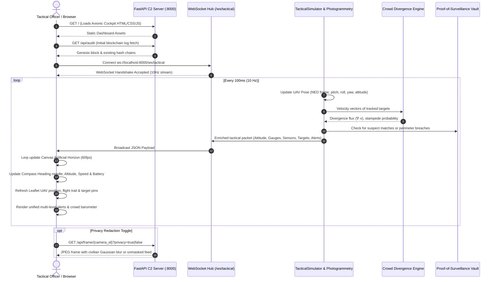

# Application Flow & UI Interaction Pipeline (AppFlow.md)
## Project: AegisDrone-GEOINT SentinelGrid-360 | CipherCop 2026
### Frontend Framework: Integrated Avionic Cockpit Dashboard (Adapted from `halilxibrahim/uav-telemetry-dashboard`)

---

### 1. End-to-End System Execution Sequence

---

### 2. Detailed Component State Flow

#### A. Avionic Flight Instruments & Horizon
1. Raw `pitch_deg`, `roll_deg`, and `yaw_deg` arrive via WebSocket every 100ms.
2. The client applies a linear interpolation (`lerp`) factor of $\alpha = 0.15$ in `requestAnimationFrame` to ensure smooth rendering on the canvas at 60fps.
3. Pitch ladder displays dynamic degree steps from $-40^\circ$ to $+40^\circ$ with sky/ground gradient clipping.
4. Compass needle SVG rotates dynamically using `transform="rotate(yaw, 14, 14)"` with cardinal direction calculation (`N`, `NE`, `ENE`, etc.).

#### B. 4D Photogrammetric Geospatial Mapping
1. Pixel bounding boxes $[u_{min}, v_{min}, u_{max}, v_{max}]$ are converted to WGS84 coordinates $(\text{lat}, \text{lon})$ via raycasting on the backend.
2. Coordinates update Leaflet target markers with real-time distance readouts from UAV nadir.
3. Suspect targets with ArcFace $> 0.70$ cosine similarity trigger red pulsing halos and populate the Biometric Watchlist Hit Card.

#### C. DPDP Act 2023 Privacy Redaction
1. Officer toggles `DPDP 2023: ACTIVE` / `RAW LAW ENFORCEMENT` in header.
2. Video frame requests append `?privacy=true` or `?privacy=false`.
3. Non-suspect civilian faces and bodies receive a 35px Gaussian blur with selective unmasking of active criminal warrants.
