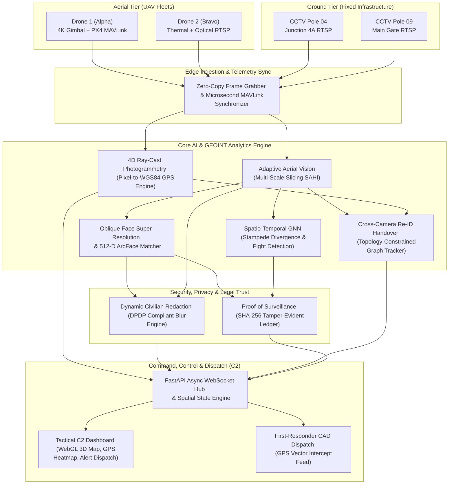

# System Architecture & Topology
## AegisDrone-GEOINT: Unified Aerial-Ground Tactical Surveillance Grid (SentinelGrid-360)
**CipherCop 2026 Hackathon** | **Track 1** | **Team Gradient Ascent**

---

### 1. High-Level Distributed Topology

---

### 2. Micro-Engine Component Breakdown

1. **`src/geoint/raycaster.py` (`GeoRayCastEngine`):**
   - Inputs: 2D bounding boxes $(u_{min}, v_{min}, u_{max}, v_{max})$, drone altitude $z_d$, drone GPS $(lat_d, lon_d)$, gimbal angles $(\theta, \phi, \psi)$, camera matrix $K$.
   - Output: Real-world ground polygon, ground target GPS $(lat_t, lon_t)$, ground footprint area $(m^2)$, and ground speed $(km/h)$.

2. **`src/vision/aerial_detector.py` (`AerialVisionEngine`):**
   - Inputs: Video frames (1080p / 4K).
   - Execution: SAHI-style multi-scale tile processing with non-maximum suppression; detects small objects (pedestrians, vehicles, weapons) down to 12x12 pixels.
   - Output: Class labels, confidence scores, pixel coordinates.

3. **`src/vision/face_recognizer.py` (`AegisFaceEngine`):**
   - Inputs: Cropped face regions from aerial drone feeds.
   - Execution: Perspective unwarping $\to$ High-frequency detail super-resolution $\to$ 512-D L2-normalized ArcFace embedding $\to$ Cosine similarity query against registered criminal gallery.
   - Output: Suspect identification, match confidence, active warrants.

4. **`src/vision/crowd_anomaly.py` (`CrowdAnomalyEngine`):**
   - Inputs: Optical flow fields and tracked person bounding box trajectories.
   - Execution: Spatio-temporal divergence flux calculation ($\nabla \cdot \vec{v}$) and skeletal altercation kinetics.
   - Output: Stampede risk level (LOW/MED/CRITICAL), violent fight detection alerts.

5. **`src/tracking/mtmc_tracker.py` (`CrossPlatformTracker`):**
   - Inputs: Detections and 4D coordinates across multiple camera nodes (UAV 1, UAV 2, CCTV 1, CCTV 2).
   - Execution: Spatio-temporal topological graph association using Kalman velocity forecasting and deep appearance Re-ID.
   - Output: Unified Global Track ID (`GT-XXXX`) persisting across camera boundaries.

6. **`src/security/audit_vault.py` (`ProofOfSurveillanceVault`):**
   - Inputs: Incident events (target matches, geofence breaches, fight alerts).
   - Execution: Cryptographic SHA-256 hash chaining with sequential nonce and HMAC signature.
   - Output: Cryptographic audit report and verification proof for judicial submission.

7. **`src/security/privacy_redact.py` (`PrivacyRedactionEngine`):**
   - Inputs: Raw video frame + detected face bounding boxes + watchlist match flags.
   - Execution: Automatically applies Gaussian feather blurring to all non-watchlist faces; unmasks only confirmed suspects.
   - Output: Privacy-compliant video stream for civilian monitoring compliance.

8. **`src/server/app.py` & Tactical C2 Console:**
   - Full asynchronous FastAPI backend with WebSocket streaming at 30 updates/sec.
   - Interactive Leaflet/WebGL map plotting live drone positions, target paths, heatmaps, and one-click dispatch.
